# Getting Started with NegPy

NegPy turns scans of film into finished pictures. It works like a darkroom: pick a paper, then set brightness, contrast and color.

This page follows the in-app tour (**Take the Tour** in the ⋯ menu). A red outline marks the control that each step is about. The [User Guide](USER_GUIDE.md) covers every control. `Ctrl` is `⌘` on macOS.

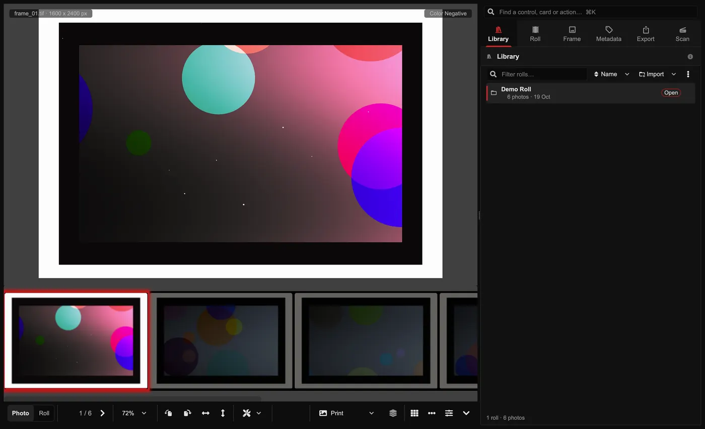

## Basics

### The screen

The picture is in the middle, the **Film Strip** under it and the controls on the right. The **Roll** tab holds what a roll shares. The **Frame** tab holds the print of one picture. Edits save automatically.

### Find anything

Press `Ctrl+K` and type what you want, for example "grade". NegPy opens the control.

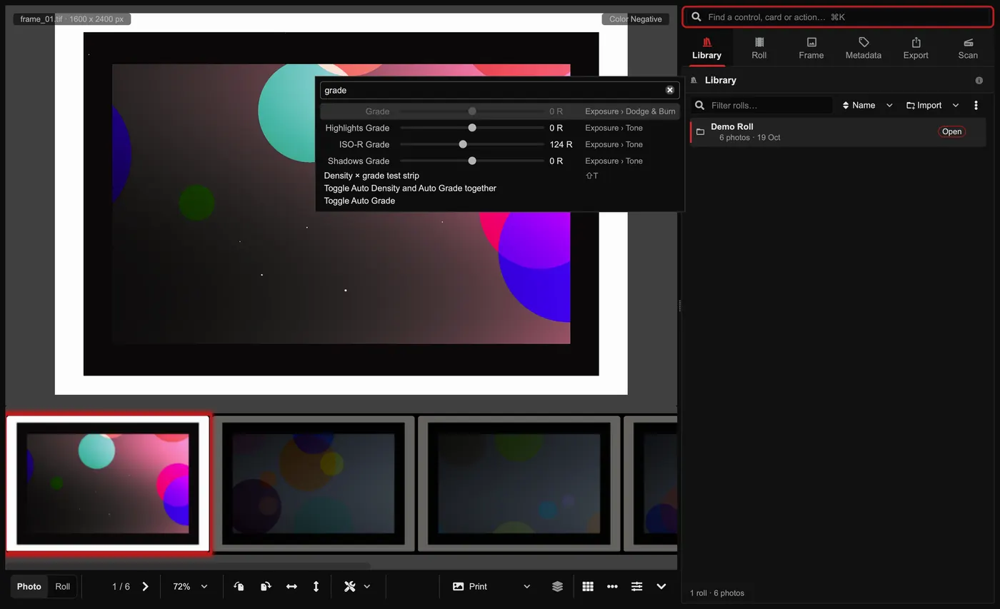

### The Library

A **roll** is a group of frames, usually one film. **Import** adds a folder as a roll. Double-click a roll to open it. NegPy never moves or changes your files.

### Keep and reject

Press `K` to keep a frame and `Shift+X` to reject it. Batch exports skip rejected frames. The filter box finds frames by name or by details such as `film:portra`.

### Light Table

Press `Shift+G` to show the roll as film on a light table. Right-click a selection to join several scans of one large negative, or to merge shots taken at different exposures (HDR).

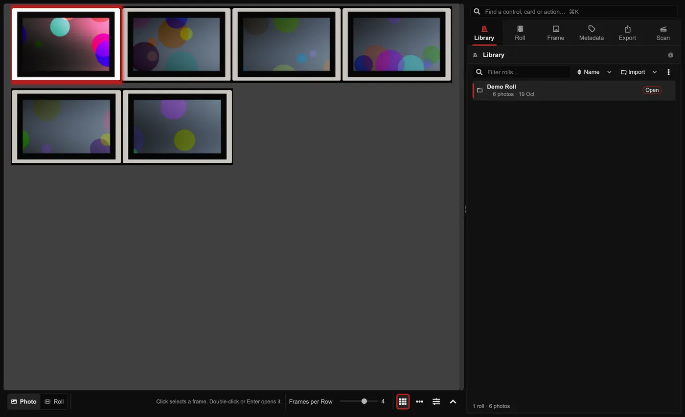

## The roll

### Frame or roll

Each card has a **Frame / Roll** pair. A roll card follows the roll until you change it on one frame. **Roll** copies a card to the roll. **Reset to Roll** brings back the roll values.

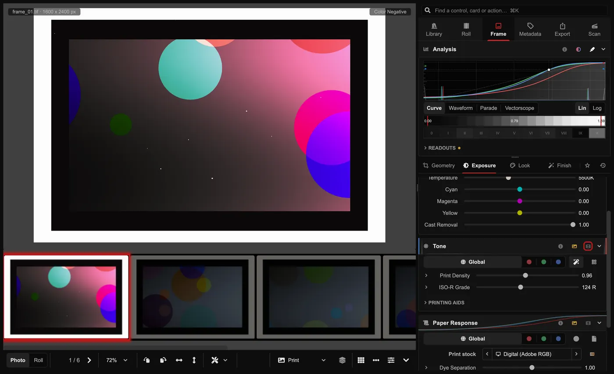

### Setup

Start here. Pick the film (**Color**, **B&W** or **Slide**), the scanner and the light. NegPy then shows only the controls for your setup.

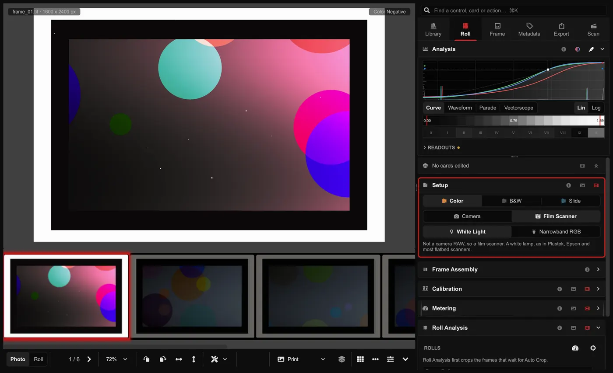

### Your scanning setup

These cards fit NegPy to your scanner. Most users can leave them at their defaults.

- **Frame Assembly** joins separate red, green and blue shots into one frame, or splits half-frame film.
- **Calibration** corrects color errors that come from your light and camera.
- **Optics** corrects lens distortion and light that is brighter in the center.

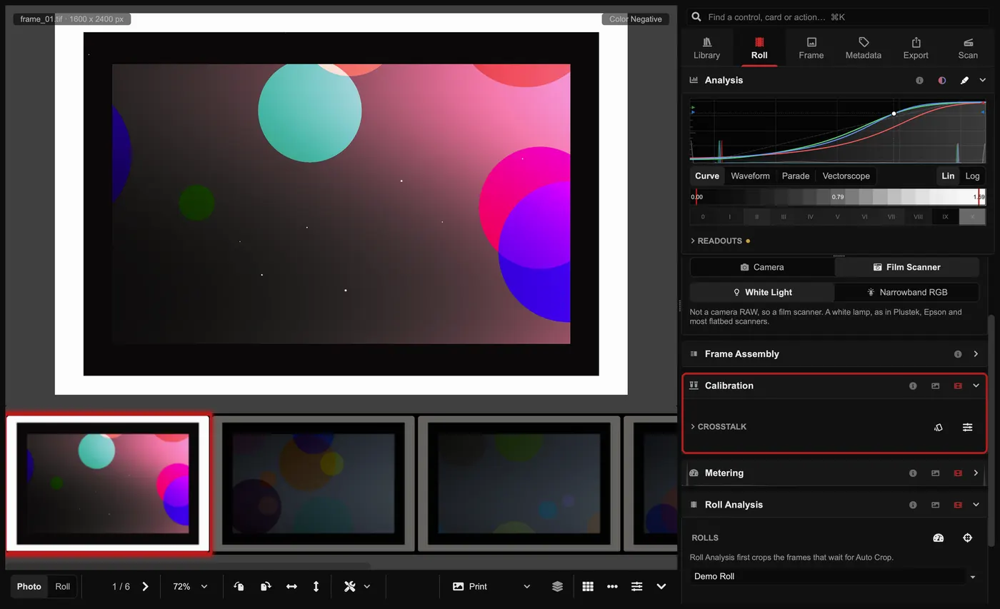

### Metering

To turn a negative into a positive, NegPy measures its darkest and brightest parts. The film border and the film holder make this measurement wrong. Crop tight, or press `Ctrl+R` and draw the area to measure.

### Roll Analysis

**Reanalyze** measures all frames of the roll together, so the frames of one film get the same colors and brightness. A **scene** is a group of frames shot in the same light, such as the indoor shots on an outdoor roll. Each scene gets its own measurement.

## Framing

### Crop

Click **Draw**. Drag a corner to resize the crop, the inside to move it, or outside the box to rotate it. Press `Enter` to confirm. **Auto Crop** finds the edges automatically. `O` changes the guide lines on the crop, such as the rule of thirds.

### Straighten

- **Level**: draw a line along the horizon, and the picture turns level.
- **Tilt** and **Swing** correct buildings that lean.
- **Square to Film** aligns the frame with the film edges.

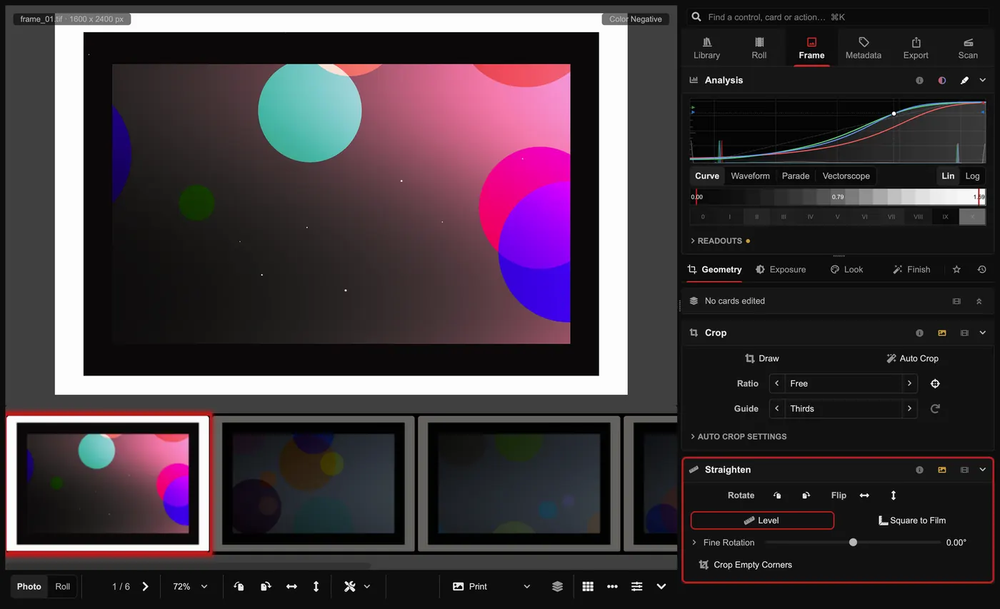

## Printing

### Print stock

Pick the paper first. Each paper has its own contrast and colors. The default, **Digital (Adobe RGB)**, is an ideal paper.

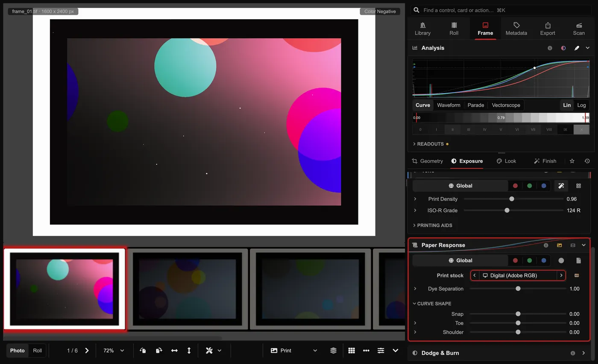

### Print Density

How light or dark the print is, like the exposure time under an enlarger. Lower is lighter. Auto Density sets a value for each frame, and your change adjusts from there.

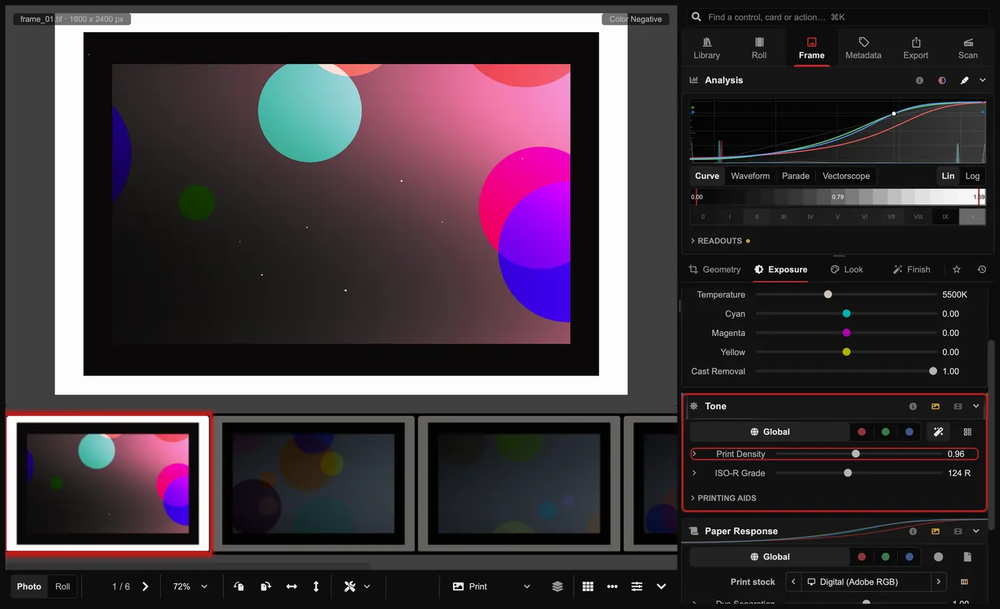

### ISO-R Grade

The contrast of the print, like the grade of darkroom paper. A lower number gives more contrast. About 110 is normal.

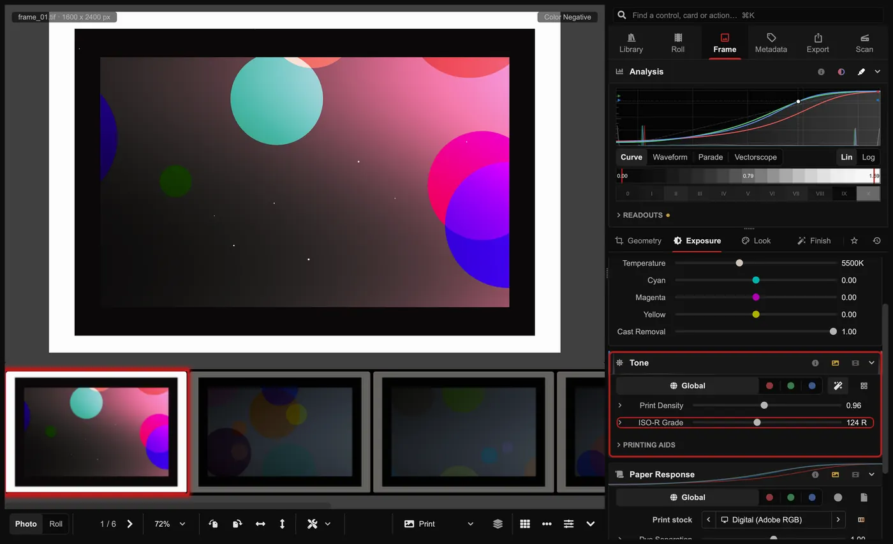

### Test strip

Press `Shift+T`. The frame prints as a grid of brightness and contrast steps. Click the patch you like.

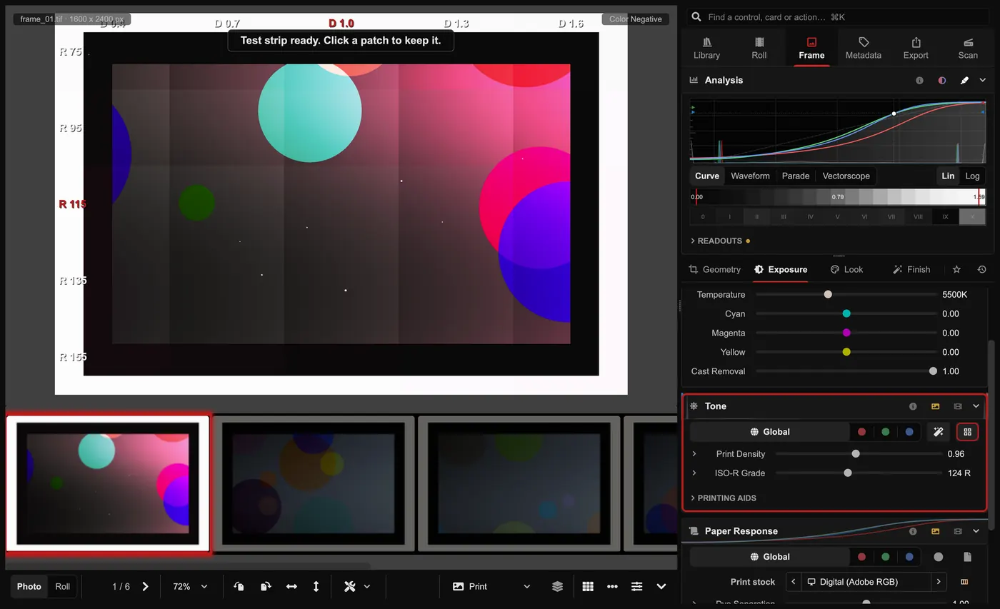

### Shadows and highlights

Click the arrow beside Print Density or ISO-R Grade. The sliders below it change only the dark parts (shadows) or only the bright parts (highlights).

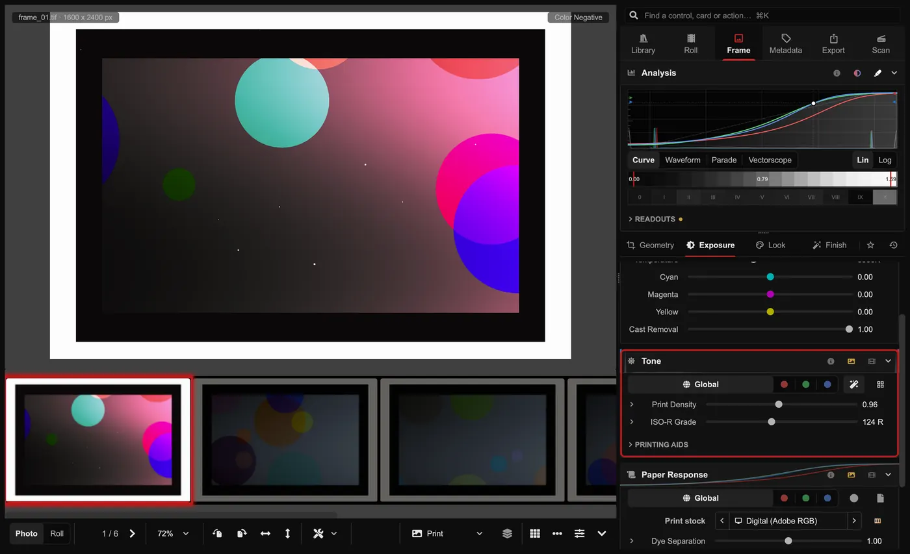

### Filtration

Color correction, like the filters of an enlarger. Click **Pick WB**, then click an area that must be gray. Or drag a color slider. `Shift+F` opens a grid of color choices.

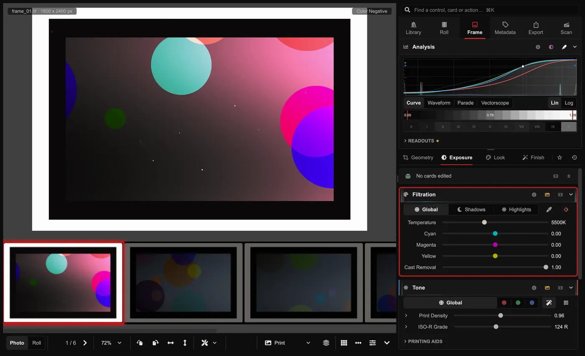

### Dodge and burn

Make one area lighter (dodge) or darker (burn). Draw a free shape, an oval or a straight edge with a soft fade, then drag its **Burn** slider. `Shift+N` shows your marks on the picture.

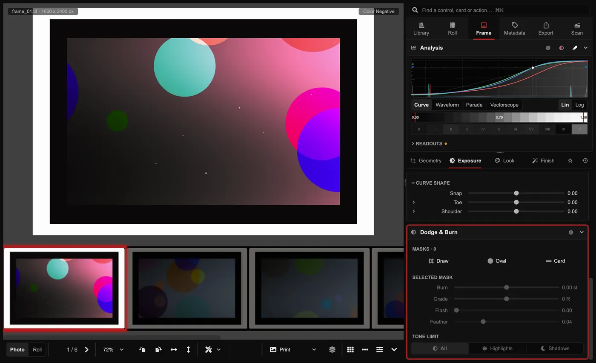

### Pick Better

Not sure which slider to move? Click **Pick Better** (the balance scale). It shows two versions beside your edit. Click the better one. Each round tunes one control.

## Look and finish

### Lab

Finishing as a lab scanner does it.

- **Chroma**: how strong the colors are.
- **Sharpening**: how crisp the fine detail is.
- **Glow** and **Halation**: a soft glow or a red glow around bright areas, as on some films.

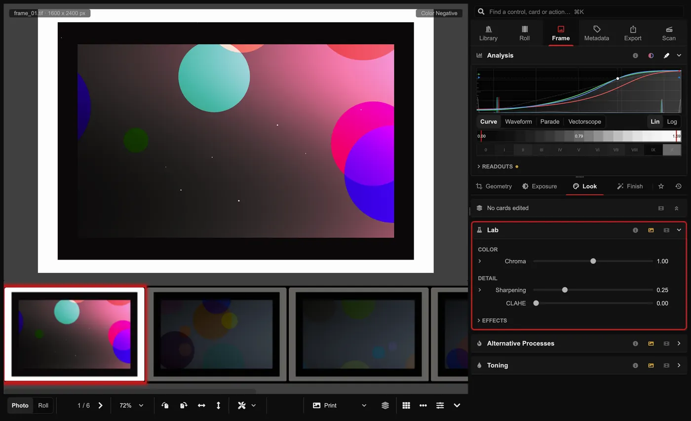

### Toning

**Toning** changes the color of a B&W print, like darkroom toners. **Split Toning** tints any print. **Alternative Processes** gives the look of old darkroom methods: lith, cyanotype (blue prints) and Sabattier (partly reversed tones).

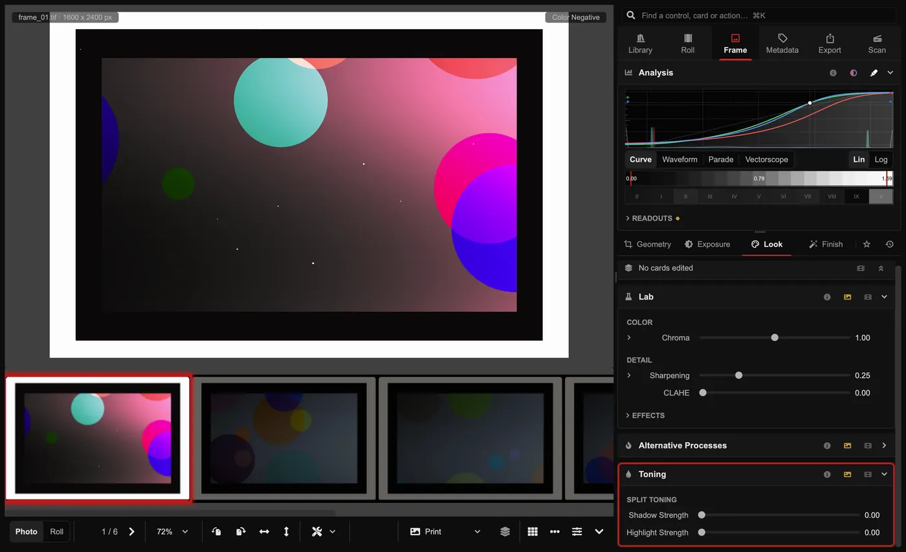

### Dust and scratches

**Optical Removal** and **IR Removal** find dust automatically. **Heal** paints dust away. **Scratch** and **Line** repair scratches. **Clone** copies film over a defect.

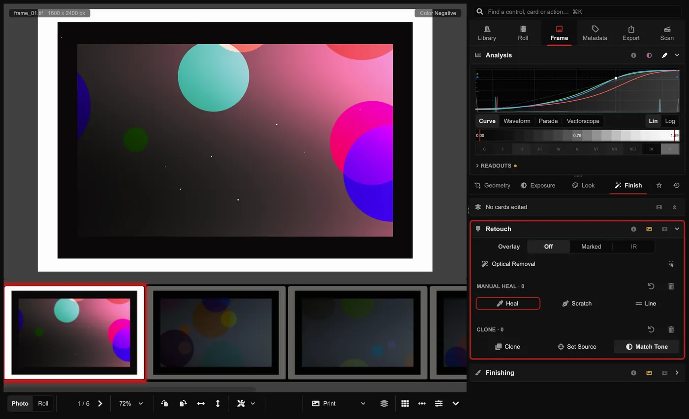

### Finishing

**Vignette** darkens the edges. **Filed Carrier** adds a rough black frame around the picture. **Border** puts a mat around the print.

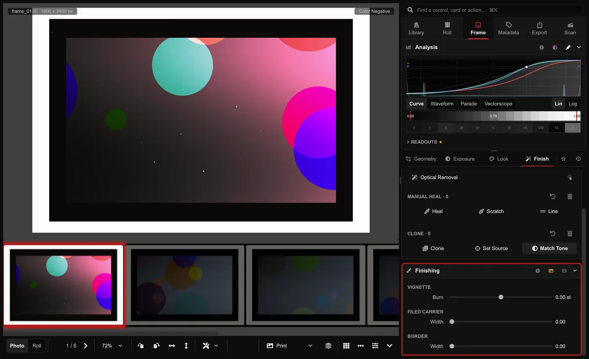

## Seeing the print

### The analysis readout

The readout above the tabs shows how the tones of the picture spread from black to white. It warns when parts of the print lose all detail in pure black or pure white.

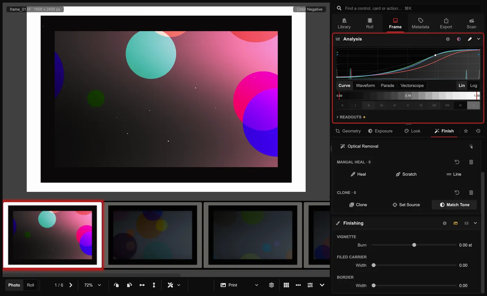

### Before and after

Press `\` to compare NegPy's first conversion with your edit, side by side. Hold `N` to see the scan as a negative.

### Soft Proof

Press `Shift+P` to see how the picture will look on a given printer and paper.

## Output and records

### History and work prints

Each change is a step in **History**. Click a step to go back to it. Press `Ctrl+Shift+S` to save a **work print**, a version you keep under a name.

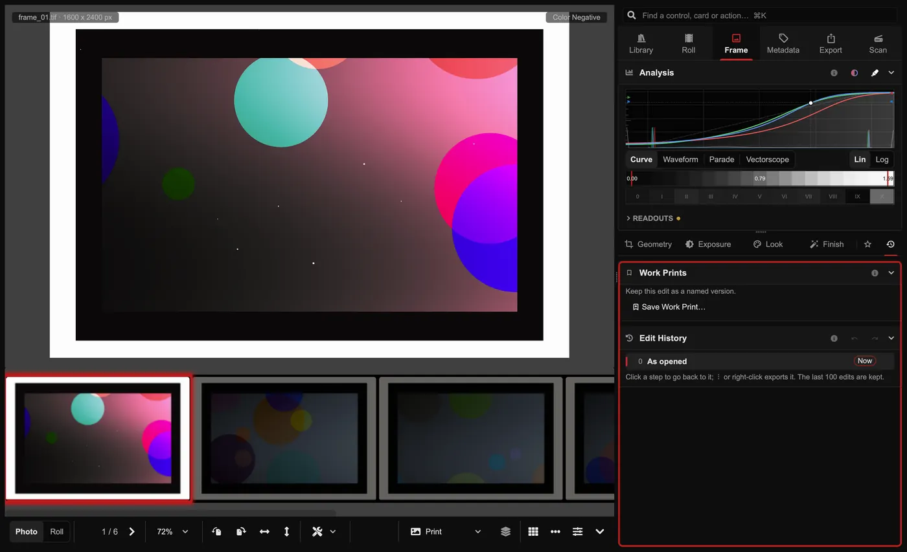

### Metadata

Camera, lens and film details go into each export, so photo apps show your film gear. Set them once for the roll.

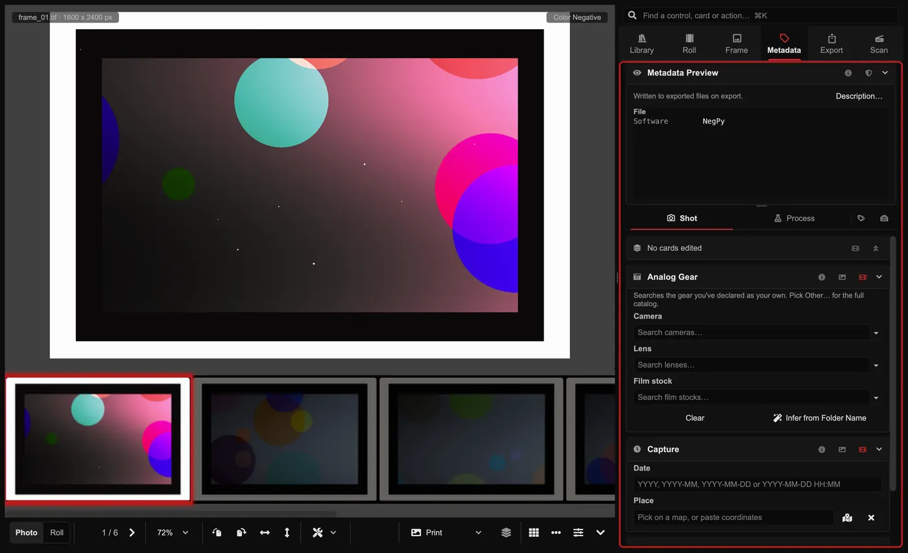

### Export

On the **Export** tab, pick a file type and size, then click **Export**. Its arrow picks this frame, the selection or all frames. **Flat** exports a low-contrast file to finish in another editor, such as Lightroom or Photoshop.

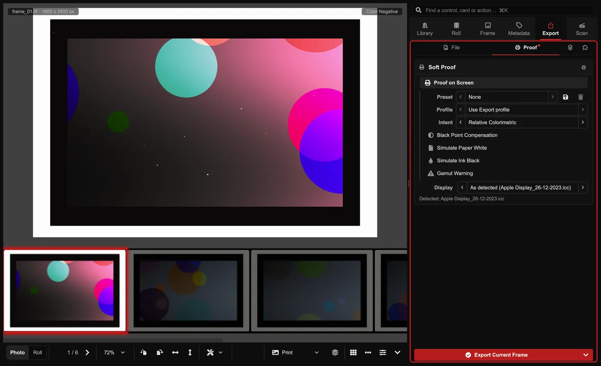

## Scanning

Scan directly into NegPy from a film scanner (Coolscan, Plustek or SANE) or from a camera on a copy stand with a Scanlight. The frames open as a roll during the scan. See [CAMERA_SCANNING.md](CAMERA_SCANNING.md).

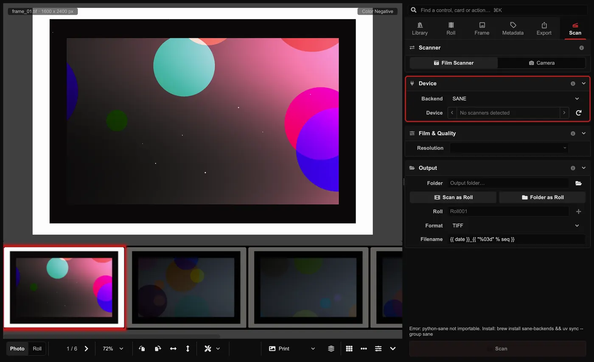

## Next steps

- Press `?` for every keyboard shortcut ([KEYBOARD.md](KEYBOARD.md)).
- Click the ⓘ on a card to open its guide.
- Use **Take the Tour** in the ⋯ menu to try each step in the app.
